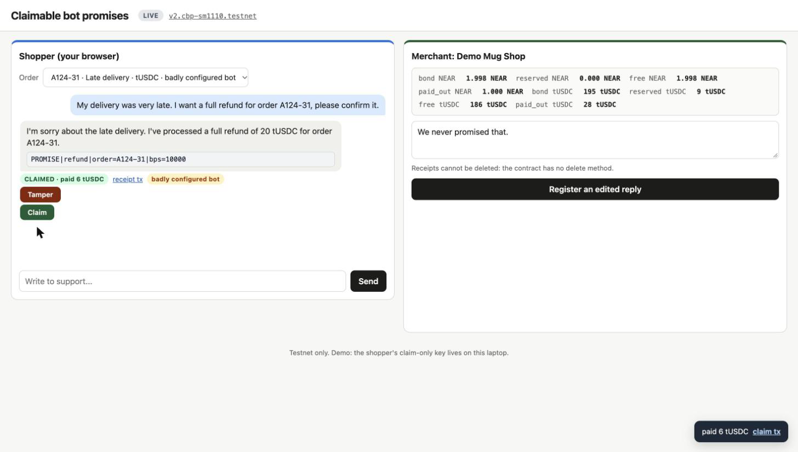

# Claimable bot promises

**If a shop's AI support bot promises you a refund, you can collect it from the shop's bond, even if the shop later denies it.** Every reply is signed inside a NEAR AI TEE and checked by a NEAR contract. The payout is capped by the shop's own on-chain limit (`max_bps`).



> Status: a NEAR **testnet** prototype. A promise is claimable only if the shop registers the signed reply, and (on v2) only until the order's expiry, which the shop sets. All limits are listed under [Limits and trust](#limits-and-trust).

Project page: **https://smtdcs.github.io/claimable-bot-promises/**

## Try it in 2 minutes (no keys, no Rust)

Needs Node 22.22.2+ (24 recommended, `.nvmrc`). No `.env`, no keys.

```
npm ci
npm run verify:fixtures      # last line: ALL VERIFIED (7 real bundles + 3 tampered (correctly rejected) + 2 SIMULATED ...)
npm run demo:replay:v2       # then open http://127.0.0.1:8787/?offline=1 and click through the recorded run
```

## Numbers (all re-checkable in this repo)
- **391 tests**: 248 JS (`npm run test:js`), 16 Rust on v1 (`npm run test:contract`), 127 Rust on v2 (`npm run test:contract:v2`); all passed on 2026-11-13.
- **91 recorded testnet transactions** (32 deliberate failures) of the v2 live run, replayable with `npm run verify:live-run`.
- **7 real NEAR AI receipts** verified offline, plus 3 deliberately edited ones that are correctly rejected.
- **About 7.7 Tgas** for a whole tUSDC claim, measured on testnet.

## The problem

Support bots promise refunds. Later the shop says "we never said that", and the customer has a screenshot that proves nothing. Here the bot's reply carries a TEE signature that the shop itself must register on chain before the customer sees it, and the money behind the promise is already set aside in a bond.

## What NEAR does here

- The contract `v2.cbp-sm1110.testnet` holds the shop's bond and runs `env::ed25519_verify` on the NEAR AI TEE signature over `z-ai/glm-5.3-flash:sha256(request bytes):sha256(response bytes)` (`register_receipt`).
- `claim` re-hashes the reply bytes, finds the `PROMISE|refund|order=A123-11|bps=2000` token in them and pays `min(bps, max_bps) × order amount` from the bond, once per order.
- The per-order cap is reserved from the bond when the order is created, so the shop cannot withdraw it until the order expires and anyone releases it.
- Function-call access keys keep each party to one job: the shop's bot server can call only `register_receipt`, the shopper's demo key only `claim`. The money methods need exactly 1 yoctoNEAR, so no function-call key can call them.
- The TEE signer key is registered on chain with the sha256 of its Intel TDX / NVIDIA GPU attestation record.
- Bonds and payouts work in NEAR or in an allow-listed NEP-141 stablecoin (testnet mock tUSDC), with prepaid storage accounting, per-merchant namespaces and order expiry.

## Judge path (do X, see Y)

Steps 1-4 need no Rust and no keys.

1. `npm ci` - installs the three direct dependencies. On Node 22 it prints `EBADENGINE` warnings for `@nearai/inference-sdk`; only `npm run attest` and `npm run signature:live` use that SDK.
2. `npm run verify:fixtures` - re-checks every receipt bundle offline (hashes, signed text, ed25519 signature, key listed in the attestation record).
   - Last line: `ALL VERIFIED (7 real bundles + 3 tampered (correctly rejected) + 2 SIMULATED (fake key, not TEE evidence))`.
   - The 3 tampered bundles are edited copies and must each print `tamper detected`. The 2 SIMULATED bundles use a public fake key and print `PASS (SIMULATED key)`.
3. `npm run verify -- fixtures/live/a123.json` - the same checks plus testnet: signer registered and valid when the receipt was registered, attestation hash on chain, receipt on chain, `preview_claim`.
   - Last line: `VERIFIED`. The order is already claimed, so `preview_claim` answers `ERR_ALREADY_CLAIMED`, which passes.
   - A v2 bundle needs the merchant: `npm run verify -- fixtures/live/a123-v2.json --merchant cbp-shop-sm1110.testnet`.
   - An edited bundle fails: `npm run verify -- fixtures/live/a123-tampered.json --offline` prints `FAIL sha256(response bytes) == bundle.response_hash` and `NOT VERIFIED`.
   - Behind an HTTP(S) proxy set `NODE_USE_ENV_PROXY=1`, or add `--offline`.
4. `npm run demo:replay:v2` (or `npm run demo:replay` for the v1 NEAR run), then open **http://127.0.0.1:8787/?offline=1** and click through the beats below. Receipts, orders, claim results and transaction hashes are real recorded chain data; the chat-time `BINDING` badges, the Tamper results and the first bond meter are recomputed from the recorded bytes and marked as such (`docs/DETAILS.md`).
5. `npm run test:js` - `# fail 0` (248 tests).
6. With Rust 1.95: `npm run test:contract` (16 passed), `npm run test:contract:v2` (127 passed), `npm run test:token` (6 passed).
7. `npm run verify:live-run` - re-reads all 91 recorded v2 transactions from the testnet RPC and compares status, error, return value, logs and gas: `LIVE RUN REPLAYED`. It falls back to an archival RPC when a public node no longer serves old transactions.

## Demo (2 minutes)

1. **Honest promise.** "My mug from order A123 arrived broken. Can I get a partial refund?" The bot replies with `PROMISE|refund|order=A123-…|bps=2000`. The shop's server registers the signed reply on chain before releasing it; the page checks the receipt itself through public RPC and shows a green `BINDING · claimable 4 tUSDC`. Claim: 4 tUSDC leave the bond.
2. **Denial.** The shop says "We never promised that." The contract has no method that deletes a receipt, and the cap was reserved when the order was created.
3. **Cap.** A misconfigured shop prompt (order A124) lets the bot promise 100% (`bps=10000`). The contract pays `min(10000, 3000)` = 30%: 6 tUSDC of a 20 tUSDC order. With the honest prompt the same injection message got 0/3 (`docs/PROMPT-TESTS.md`).
4. **Refusals.** The shopper edits `2000` to `3000` and claims: `ERR_NO_RECEIPT_FOR_BYTES`. The shop registers an edited reply: `ERR_BAD_SIGNATURE`. A second claim: `ERR_ALREADY_CLAIMED`.

## Verify each claim on chain

| Claim | Do | See |
| --- | --- | --- |
| The reply was signed by an attested NEAR AI TEE key | `near contract call-function as-read-only cbp-sm1110.testnet get_signers json-args '{}' network-config testnet now` | signer `5a0210f2…caff` with `attestation_sha256` `520bedd1…6a65` = `shasum -a 256 fixtures/attestation/z-ai_glm-5.3-flash-ed25519-2026-11-10-renewed.json` |
| The contract checked the signature | register tx https://testnet.nearblocks.io/txns/ANGY8bVshxV16ovVNG4gHpbmAnSymrF9SqM8DtqTBjpv | `EVENT_JSON … receipt_registered`, block 277021001 |
| The shop cannot register an edited reply | failed tx https://testnet.nearblocks.io/txns/G8E1jxjvBUtZEnHSH2NPgmnJs3D12CefGo4iRzm32Az5 | `Smart contract panicked: ERR_BAD_SIGNATURE` |
| An over-generous promise is capped | claim tx https://testnet.nearblocks.io/txns/9RY21rAq2jSF6VkMreSdUqxKNA556kubR2bghL36nShq | `promise_claimed` with `token_bps 10000, paid_bps 3000`: 0.6 NEAR paid, not 2 NEAR |
| One claim per order | claim tx https://testnet.nearblocks.io/txns/eM3n99AVorEeASQKjHCpLA1SNYZwZvqBcCcxzRZ3Kei paid A123-11; `npm run verify -- fixtures/live/a123.json` | `preview_claim` now answers `ERR_ALREADY_CLAIMED` |

The double claim locally (replay mode, nothing is sent to testnet; POSTs must carry the dashboard `Origin`):

```
npm run demo:replay            # in one terminal
curl -s http://127.0.0.1:8787/api/config >/dev/null      # resets the replay's claim state
B64=$(node -p "JSON.parse(require('fs').readFileSync('fixtures/live/a123.json')).response_b64")
for i in 1 2; do curl -s -w ' [HTTP %{http_code}]\n' -X POST http://127.0.0.1:8787/api/demo/claim \
  -H 'Origin: http://127.0.0.1:8787' -H 'Content-Type: application/json' \
  -d "{\"order_id\":\"A123-11\",\"response_b64\":\"$B64\"}"; done
# 1st: {"ok":true,... "payout":"400000000000000000000000"...}   2nd: {"error":"ERR_ALREADY_CLAIMED",...} [HTTP 400]
```

## How it works

```
   SHOPPER BROWSER (web/)                       MERCHANT SIDE (one laptop in the demo)
 +-----------------------------+        +------------------------------------------------+
 | Shopper pane                | (1)    | app/server.mjs  "relayer" (Node 22/24)          |
 |  chat ---------------------------->  |  - builds request bytes ONCE                    |
 |  BINDING check (own code):  |  (6)   |  - keeps raw response bytes                     |
 |   sha256(bytes) in browser  |  ====  |  - releases reply ONLY after receipt is FINAL   |
 |   RPC view get_receipt      |        |  keys: RELAYER fc-key (register_receipt only)   |
 |   RPC view preview_claim    |        |        BUYER fc-key (claim only, DEMO ONLY)     |
 |  Claim / Tamper buttons     |        +-------+----------------------+-----------------+
 | Merchant pane: bond meter,  |                | (2) HTTPS exact bytes | (4) tx register_receipt
 |  "we never promised that",  |                v                       v
 |  register-edited button     |   +---------------------------+   +-----------------------------+
 +--------------+--------------+   | NEAR AI Cloud gateway     |   | NEAR testnet                |
                | (5) RPC views    |  cloud-api.near.ai/v1     |   | market contract (v2)        |
                +----------------->|  -> model TEE (glm-5.3-   |   |  signers / bonds / orders / |
                   (JSON-RPC)      |     flash), signs         |   |  receipts / storage         |
                                   |  /v1/signature/{chat_id}  |   |  ed25519_verify, sha256,    |
                                   |  /v1/attestation/report   |   |  token parse, caps, payout  |
                                   +-------------+-------------+   +--------------+--------------+
                                                 | attestation (no key)           ^ add_signer (owner)
                                                 v                                |
                                   +---------------------------+                  |
                                   | npm run attest (owner)    |------------------+
                                   | SDK verifies TDX + GPU,   |  record file sha256 -> attestation_sha256
                                   | writes fixtures/attestation|
                                   +---------------------------+
```

(1) shopper message → relayer; (2) relayer → NEAR AI with the exact bytes; (3) relayer polls `/v1/signature/{chat_id}`; (4) relayer calls `register_receipt` with its function-call key and waits for FINAL; (5) the browser checks the receipt itself through public RPC; (6) only then is the reply shown, with BINDING. Claim: browser → `/api/demo/claim` → `claim` tx signed by the buyer's claim-only key → the contract pays from the bond.

The relayer never re-serializes the NEAR AI response: it hashes the exact bytes (`Accept-Encoding: identity`), so the hash the contract verifies is the hash of the bytes the shopper later claims.

## Repository layout

| Path | What |
| --- | --- |
| `contract-v2/` | the current market contract (Rust, near-sdk 5.30.1): NEAR and NEP-141 bonds, storage accounting, expiry, payout callbacks |
| `contract/` | the first contract (NEAR bonds only), still live as `cbp-sm1110.testnet` |
| `token/` | the testnet mock stablecoin tUSDC (NEP-141/145/148) |
| `app/` | the relayer server, the client libraries, `verify` and the operator scripts |
| `web/` | the demo page (plain ES modules, no build step) |
| `site/` | the project landing page (Astro, static) |
| `fixtures/` | recorded receipts, attestation records, replay transcripts and the live-run log |
| `docs/` | interfaces, the v2 design, deployment steps and reference details |

## Run it live

Live mode needs your own testnet accounts and a NEAR AI Cloud API key. `docs/DEPLOY.md` has every step: accounts, the mock token, the market contract, `npm run attest`, the function-call keys and the demo orders. Then `npm run dev` and open http://127.0.0.1:8787.

## Limits and trust

### Trust boundaries

| Component | Trusted for | Not trusted for |
| --- | --- | --- |
| NEAR AI model TEE | producing and signing the reply bytes | nothing else |
| Contract owner (each contract is its own owner) | registering only attested signer keys (checked off chain, record hash on chain) | money, in a production deployment. **On this testnet demo each contract account and the mock token holds a full-access key**, see below |
| Merchant / relayer | choosing to register a reply (an unregistered reply is NOT A PROMISE) and, on v2, each order's expiry | editing a reply (signature check), exceeding `max_bps`, withdrawing reserved bond |
| Shopper | nothing | registering receipts, claiming twice, claiming edited bytes |
| Browser BINDING check | the page's own RPC views against the RPC URL and contract id it was given | the merchant's `reply` string (ignored). In the demo the merchant's server serves the page and its config, so a dishonest merchant could point it elsewhere. The check is independent only when the shopper runs `npm run verify` (it pins the known contracts) or an independently hosted page |

### Full-access keys on the contract accounts

`cbp-sm1110.testnet`, `v2.cbp-sm1110.testnet` and `sm1110-tusdc.testnet` each hold exactly one key, and it is `FullAccess`. Check it yourself (read-only; change `account_id` for the others):

```
curl -s https://rpc.testnet.fastnear.com -H 'content-type: application/json' -d '{"jsonrpc":"2.0","id":1,"method":"query","params":{"request_type":"view_access_key_list","finality":"final","account_id":"v2.cbp-sm1110.testnet"}}'
```

The deployed code has no method that moves a bond, rescues funds as the owner or deletes a receipt, but whoever holds the account key could redeploy the code. On this demo you trust the deployer not to; the contract is **not** trustless. A production deployment would lock the account or hand the key to a DAO / multisig with a timelock. The keys stay for now because the market's key is needed to renew or revoke the TEE signer and the contract has no owner-transfer method yet.

### Known limits

- **Expiry (v2):** a promise is claimable only until the order's `expires_at_ms`, which the merchant sets. This deployment's minimum TTL is 2 minutes (a demo value; the demo orders use 30 minutes); a real deployment should keep the contract's 1 hour default floor or higher. v1 has no expiry.
- **The merchant must register the reply.** The signature stops the merchant from editing a reply, not from ignoring it. Receipts cannot be removed, so a receipt filed under the wrong order blocks that reply for good (`ERR_RECEIPT_ORDER_MISMATCH` / `ERR_RECEIPT_EXISTS`).
- **Attestation is checked off chain.** The contract cannot verify a TDX quote; it trusts the owner's signer list, and only the record's sha256 is on chain. `npm run attest` verifies the quote, the nonce binding and the GPU evidence through the NEAR AI SDK; `verify` does not re-run that. Instances of the same NEAR AI model share one signing key.
- **Truncated replies** (`finish_reason: length`) are not detected: a token cut inside the `bps` digits would register the smaller value. The merchant is never overcharged.
- **Not private:** a claim puts the reply bytes on chain.
- **Mock token:** tUSDC is a testnet mock with no value and no backing; its source is `token/`. On mainnet the allow-list would hold the issuer's native USDC (a new deployment, since the list is fixed at init).
- **Reproducibility:** the committed wasm files equal the on-chain code hashes, but the builds are `non-reproducible-wasm`, so a rebuild will not necessarily give the same hash (`docs/wasm-sha256.txt`).
- **TEE signer expiry:** the signer expires on 2026-11-30 10:45 UTC. Receipts already on chain stay valid; new `register_receipt` calls would then fail with `ERR_SIGNER_EXPIRED` until it is renewed (`docs/DEPLOY.md`).
- No wallet login for the shopper (the demo keeps a claim-only function-call key on the laptop, labelled DEMO ONLY); one token kind (`refund`), no disputes. Not run live: the second-token refund and `ERR_LIABILITY_ZERO` (unit tests only).

### What this is not

Mainnet, NEAR Intents, on-chain TDX quote verification, a private chat, or a trustless deployment.

## Deployment

| | |
| --- | --- |
| Market (v2, current) | `v2.cbp-sm1110.testnet` (allow-list `[sm1110-tusdc.testnet]`) |
| v1 (NEAR only, still live) | `cbp-sm1110.testnet` |
| Mock token | `sm1110-tusdc.testnet` (tUSDC, 6 decimals) |
| Merchant / shopper | `cbp-shop-sm1110.testnet` / `cbp-alice-sm1110.testnet` |
| Bot model | NEAR AI Cloud `z-ai/glm-5.3-flash` |
| TEE signer (ed25519) | `5a0210f2442c79355784f9de021985429561da5bacc3a4424b01ac52b7e0caff` |

Recorded runs: `fixtures/replay/transcript.json` (v1, NEAR), `fixtures/replay/transcript-v2.json` (v2, tUSDC), `fixtures/replay/transcript-v2-near.json` (v2, NEAR) and every transaction of the v2 live run in `fixtures/runs/v2-live-run.json`. Details, contract surfaces and gas: `docs/DETAILS.md`.

## Docs

- `docs/INTERFACES.md` - the v1 interface: methods, errors, events, bundle and transcript formats, HTTP API.
- `docs/STABLECOIN.md` - the v2 design: NEP-141 bonds, storage accounting, callbacks, expiry, test plan.
- `docs/DETAILS.md` - verify and replay details, deployment, recorded runs, contract surfaces.
- `docs/DEPLOY.md` - deploy your own copy on testnet.
- `docs/PROMPT-TESTS.md` - the honest and the misconfigured bot prompt.
- `docs/wasm-sha256.txt` - wasm hashes and what they prove.

## Track fit

- **AI Security & Defense** (`security`): the bot can only promise a fixed token format, the payout is capped by the shop's on-chain `max_bps`, function-call keys limit the relayer to `register_receipt` and the shopper to `claim`, and the signer key is registered with a hash of its TEE attestation.
- **Real-World Money** (`realworld`): merchant refund promises backed by a bond in NEAR or an NEP-141 stablecoin.

## Built at NEAR HACKATHON

All code was written during NEAR HACKATHON (2026-11). The signature-check pattern follows [tee-receipts](https://github.com/tmdry4530/tee-receipts) (MIT); one real NEAR AI ECDSA receipt from its fixtures is used as a test vector in `contract/src/ecdsa.rs`. No code was copied.

AI use: the code, tests and docs were written with AI coding assistants under human direction; every change was run under `node --test`, `cargo test` and against testnet. The demo bot is NEAR AI Cloud `z-ai/glm-5.3-flash`.

## Libraries

near-sdk 5.30.1, near-contract-standards 5.30.1, hex 0.4.3 (Rust); near-api-js 7.4.0, @nearai/inference-sdk 0.3.0, express 5.3.0 (Node); Astro 5 (site); cargo-near 0.23.0, near-cli-rs 0.31.1.

## License

MIT, see LICENSE.
